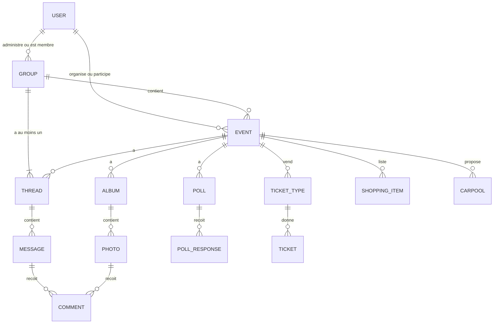

# Conception de l'API My Social Networks

Ce document explique comment l'API est construite et pourquoi. Il liste aussi les choix faits là où le cahier des charges ne tranche pas.

## 1. Objectif

Refondre les API d'un réseau social autour des événements et des groupes. Le service doit être fiable, bien structuré et documenté. Il doit respecter à la lettre les règles du cahier des charges.

## 2. Technologies

| Besoin | Outil | Raison |
|---|---|---|
| Serveur HTTP | Node.js 22 et Express 5 | Outils vus en cours. Express 5 transmet tout seul les erreurs des fonctions `async` au gestionnaire d'erreurs. |
| Base de données | MongoDB avec Mongoose 9 | Schémas, validations et index déclarés dans les modèles. |
| Authentification | JWT (`jsonwebtoken`) et `bcryptjs` | Pas de session à stocker côté serveur. Mots de passe hachés. |
| Sécurité HTTP | `helmet`, `cors`, `express-rate-limit` | En-têtes de sécurité, origines autorisées, limite de débit sur la connexion et l'achat de billets. |
| Performances | `compression`, index MongoDB, pagination | Réponses compressées, recherches indexées, listes limitées à 100 résultats par page. |
| Tests | `node:test` et `supertest` | Lanceur de tests intégré à Node.js, sans dépendance lourde. |
| Documentation | Postman | Demandé par le cahier des charges. |

## 3. Architecture

```
Requête HTTP
   -> app.js            (helmet, cors, compression, lecture du JSON, blocage des opérateurs MongoDB)
   -> routes/           (une URL = une fonction de contrôleur, vérification du format des identifiants)
   -> middlewares/auth  (vérification du token JWT, sauf routes publiques)
   -> controllers/      (lecture de la requête, appel des règles, réponse JSON)
   -> services/access   (toutes les règles de droits : qui peut voir, publier, gérer)
   -> services/cascade  (suppressions en cascade)
   -> models/           (schémas Mongoose, validations, index uniques)
   -> middlewares/error (toutes les erreurs au même format JSON)
```

Les droits sont regroupés dans un seul fichier (`src/services/access.js`). Une règle d'accès n'est donc écrite qu'à un endroit.

## 4. Modèle de données



| Collection | Champs principaux | Règle garantie par la base |
|---|---|---|
| `users` | prénom, nom, email, mot de passe haché, date de naissance, téléphone, ville, présentation, photo | Index unique sur `email` |
| `events` | nom, description, dates, lieu, photo de couverture, visibilité, organisateurs, participants, groupe, options | Au moins 1 organisateur. Date de fin après la date de début |
| `groups` | nom, description, icône, photo de couverture, type, autorisations, membres, administrateurs | Au moins 1 membre et 1 administrateur |
| `threads` | titre, groupe ou événement | Exactement un des deux champs `group` et `event` |
| `messages` | fil, auteur, contenu | |
| `comments` | cible (message ou photo), auteur, contenu | |
| `albums` | événement, nom, description | |
| `photos` | album, événement, auteur, adresse, légende | |
| `polls` | événement, titre, questions et réponses possibles | Au moins 1 question. Au moins 2 réponses possibles par question |
| `pollresponses` | sondage, utilisateur, réponse choisie par question | Index unique sur (sondage, utilisateur) |
| `tickettypes` | événement, nom, montant, quantité, vendus | Index unique sur (événement, nom) |
| `tickets` | type, événement, nom, prénom, adresse complète, date d'achat | Index unique sur (événement, personne) |
| `shoppingitems` | événement, utilisateur, nom, quantité, heure d'arrivée | Index unique sur (événement, nom normalisé) |
| `carpools` | événement, conducteur, lieu et heure de départ, prix, places, temps d'écart | Index unique sur (événement, conducteur) |

Les règles d'unicité sont portées par des index uniques dans MongoDB, pas seulement par du code. Deux requêtes simultanées ne peuvent donc pas créer un doublon.

## 5. Rôles et droits

| Rôle | Ce qu'il peut faire |
|---|---|
| Personne extérieure (sans compte) | Voir les billets en vente d'un événement public et obtenir un billet |
| Utilisateur connecté | Créer des événements et des groupes, voir ce qui est public, rejoindre un événement ou un groupe public |
| Participant d'un événement | Lire et écrire dans les fils de l'événement, commenter, poster des photos, répondre aux sondages, utiliser la shopping list et le covoiturage |
| Organisateur d'un événement | Tout ce que fait un participant, plus : modifier ou supprimer l'événement, gérer les invités, créer les fils, les sondages et les types de billets, voir les billets vendus |
| Membre d'un groupe | Lire le groupe, commenter, publier et créer des événements si le groupe l'autorise |
| Administrateur d'un groupe | Tout ce que fait un membre, plus : modifier ou supprimer le groupe, gérer les membres, créer les fils |

## 6. Choix faits quand le cahier des charges ne précise pas

1. **Authentification.** Le cahier des charges n'en parle pas, mais ses règles demandent de savoir qui fait la requête ("créé par un organisateur", "posté par un participant"). L'API utilise donc un token JWT.
2. **Parcours en trois étapes.** Seule l'étape 1 est décrite. `POST /events` couvre tous les champs de cette étape. Les options (shopping list, covoiturage) s'activent ensuite avec `PUT /events/:id`.
3. **Visibilité par défaut.** Un événement ou un groupe créé sans préciser sa visibilité est privé. C'est le choix le plus prudent pour les données des utilisateurs.
4. **Organisateur et participant.** Un organisateur a aussi les droits d'un participant. Il n'apparaît que dans la liste des organisateurs.
5. **Invitation.** Être invité à un événement signifie être ajouté à ses participants. Il n'y a pas d'état "en attente de réponse".
6. **Types de groupe.** Public : visible et lisible par tous. Privé : visible par tous, contenu réservé aux membres. Secret : invisible pour les non-membres (réponse 404).
7. **Fil de discussion d'un groupe.** Il est créé automatiquement avec le groupe, et un groupe garde toujours au moins un fil. Pour un événement, les organisateurs créent les fils à la demande.
8. **Publier et commenter.** Le paramètre "autoriser les membres à publier" concerne les messages. Les commentaires restent ouverts à tous les membres, comme le demande la règle 2.4.
9. **Photos.** Une photo est enregistrée par son adresse (URL). L'API ne stocke pas de fichier.
10. **Un seul billet par personne extérieure.** Une personne extérieure n'a pas de compte. Elle est reconnue par son nom, son prénom et son adresse complète, comparés sans tenir compte des majuscules, des accents et des espaces. La limite s'applique par événement.
11. **Billetterie.** Un événement a une billetterie dès qu'il possède un type de billet. Il doit alors rester public. La vente s'arrête à la fin de l'événement.
12. **Shopping list.** Le nom d'un élément est unique par événement, comparé sans majuscules ni accents. L'heure d'arrivée ne peut pas être après la fin de l'événement.
13. **Covoiturage.** Un utilisateur propose un seul covoiturage par événement, avec 1 à 8 places. Le temps maximum d'écart est en minutes.
14. **Partage sur les autres réseaux.** L'API renvoie des liens de partage. Elle est réservée aux organisateurs d'un événement créé dans un groupe public, comme le dit le cahier des charges.
15. **Modification.** Les routes `PUT` ne modifient que les champs envoyés.
16. **Suppression d'un compte.** Elle est refusée si l'utilisateur est le seul organisateur d'un événement ou le seul administrateur d'un groupe. Ses messages, photos et commentaires sont conservés, sans auteur.
17. **Suppression d'un groupe.** Ses fils de discussion sont supprimés. Ses événements sont conservés et détachés du groupe.

## 7. Fiabilité et performances

- **Opérations atomiques.** L'achat d'un billet réserve la place avec une seule opération MongoDB qui vérifie la quantité restante. Les ajouts et retraits de participants et de membres utilisent `$addToSet` et `$pull`. Deux requêtes simultanées ne se marchent pas dessus. Ces deux points sont couverts par des tests.
- **Dernier organisateur, dernier administrateur.** La vérification et le retrait se font dans la même opération.
- **Index.** Chaque recherche fréquente a un index (événements par date et visibilité, messages par fil, photos par album...).
- **Listes légères.** Les listes sont paginées, lues en mode `lean` et renvoient des compteurs plutôt que des listes complètes de participants.
- **Suppressions en cascade.** Supprimer un événement supprime tout son contenu. Aucun document orphelin ne reste en base.

## 8. Sécurité

- Mots de passe hachés avec bcrypt, jamais renvoyés par l'API.
- Tokens JWT signés en HS256, valables 2 heures par défaut. Un changement de mot de passe invalide tous les tokens déjà émis.
- Le secret JWT est obligatoire et doit faire au moins 32 caractères. Le serveur refuse de démarrer sinon.
- Même message d'erreur pour un email inconnu et un mauvais mot de passe.
- Limite de débit sur l'inscription, la connexion et l'achat de billets.
- Blocage des injections NoSQL : les clés qui commencent par `$` ou contiennent un point sont refusées, et les recherches échappent les caractères spéciaux.
- Seuls les champs prévus sont lus dans le corps des requêtes. Un client ne peut pas modifier un champ interne.
- Les adresses d'images doivent commencer par `http://` ou `https://`.
- L'email, le téléphone et la date de naissance d'un utilisateur ne sont visibles que par lui. Les données des acheteurs de billets ne sont visibles que par les organisateurs.
- Un groupe secret répond 404 aux non-membres, et son nom n'apparaît pas dans le détail d'un événement public.

## 9. Limites connues

- Pas de paiement réel : obtenir un billet enregistre l'achat sans transaction bancaire.
- Pas d'envoi de fichiers : les photos et images sont des adresses.
- Pas de notifications ni d'emails d'invitation.
- La limite de débit est gardée en mémoire. Avec plusieurs serveurs, il faudrait un stockage partagé comme Redis.
- Le covoiturage enregistre les offres des conducteurs. La réservation d'une place par un passager n'est pas demandée par le cahier des charges et n'est pas incluse.
